# Nordvik Portal

**Nima Kamali**
https://github.com/nima1233/azure-MOV25/tree/main/examination


## Portalen
Nordviks Portal är byggd med Azure tjänster som håller i infrastrukturen. Lösningen använder en serverless arkitektur för att minska behovet av att administrera servrar och för att kunna anpassa och spara resurser automatiskt beroende på användnigen. 


### COMPUTE
Azure Functions används för portalens backend och API. Funktionen hanterar exempelvis felanmälningar som skickas in av hyresgäster, tar emot information och bilder samt hämtar och uppdaterar befintliga ärenden. 

Azure Functions kör kod vid inkommande HTTP anrop och kan skalas efter behov. Istället för att själv administrera en virtuell server ansvarar Azure för den underliggande infrastrukturen. Function App körs på en Windows Consumption plan, vilket innebär att "datorn" hanteras av Azure och att kostnaden huvudsakligen baseras på användningen. Microsoft Azure har en 99.5% uptime SLA (Service Level Agreement) på serverless Consumption plan som jag valt.

### NÄTVERK OCH ÅTKOMST
Azure Static Web Apps används för att publicera portalens frontend, det vill säga webbgränssnittet som hyresgäster och personal använder. Frontend kommunicerar med backend via Azure Functions API.

Lösningen använder flera säkerhetslager. Microsoft Entra ID används för autentisering, medan rollbaserad behörighet begränsar vilka funktioner olika använder får använda. Azure Functions hanterar åtkomsten till felanmälningar och Blob Storage är konfigurerad för att inte tillåta anonym åtkomst. Functionens hanterade identitet används för åtkomst till lagringen utan att lagringsnycklar behöver lagras i koden. Användarna loggar in med sina konton och tilldelas rollerna Tenant, Manager, eller Finance. Backend kontrollerar användarens behörighet innan en åtgärd tillåts. Det innebär att en hyresgäst endast ska kunna se sina egna felanmälningar, medan en förvaltare kan hantera alla ärenden och ekonomi bara har läsbehörighet.

Storage kontots publika blobåtkomst är avstängd. Detta förhindrar att filer läses anonymt. RBAC har varit i fokus under planeringen och lösnigen för Nordviks Portal. Portalen (function app) har en Managed identity med rollen Storage Blob data-contributor endast på containern felanmalan så att den kan lagra, läsa, samt modifera filer. 

### LAGRING
Storage account med Blob storage används för att lagra felanmälningar och tillhörande bilder, besiktningsprotokoll, och kontrakt. Standardåtkomstnivå Hot då ärenden kommer in och filer kan behövas ändras/läsas in snabbt. 

Anonym blob access är AV för extra säkerhet, endast de med direkt åtkomst kommer åt uppgifterna här. Genom att ge åtkomst med Managed identity till lagringen minskar risken att SAS nyckel eller liknande lösning kan "läcka" och ge otillåten inkomst in till lagringen med känslig kundinformation. Livscykelhantering är på (endast aktiv för containarna besiktning och kontrakt) för att arkivera filer som inte modifierats på 3 månader. Hjälper Nordvik med lagringskostnaderna genom att de flyttas till cold storage. 

Azure Functions använder även lagringskontot för vissa interna funktioner. Därför kan Azure automatiskt skapa containrarna azure-webjobs-hosts och azure-webjobs-secrets. Dessa används av Functions miljön och är separata från containern som lagrar Nordviks felanmälningar

## VIRTUALISERINGSNIVÅER
Det finns flera sätt att köra applikationer i molnet. De viktigaste nivåerna i den här uppgiften är virtuella maskiner, containrar, och serverless.

### VM
En virtuell maskin är en emulerad dator med ett eget operativsystem. Man ansvarar vanligtvis själv för operativsystems konfiguration, uppdatering, säkerhet, och program. En VM ger stor kontroll över miljön men kräver mer administration. 

För Nordviks Portal skulle en VM exempelvis kunna köra en webbserver och en Flask applikation, men man skulle även behöva hantera serveruppdateringar, processer, skalning, samt betala under natten när servern inte används.

### CONTAINER
En container paketerar applikationens kod och beroenden så att den kan köras i en isolerad miljö. Containrar är normalt lättare att köra än virtuella maskiner. Containrar kan exempelvis köras med Azure Container Apps eller Azure Kubernets Service. De ger kontroll över applikationens körmiljö och passar bra när man vill paketera och distribuera en applikation konsekvent. Däremot behöver man fortfarande välja hur containrar ska köras, övervakas, och skalas.

### SERVERLESS
Serverless innebär att utvecklaren fokuserar på applikationens funktioner i stället för att administrera servrar. Azure hanterar den underliggande infrastrukturen och kan skala kapaciteten efter belastningen.

Azure Functions är ett exempel på serverless compute. Funktionen körs när den anropas, exempelvis när en huresgäst skickar in en felanmälan. Kostnadsmodellen beror på vald plan, med Consumption planen baseras kostnaden huvudsakligen på användningen.

Serverless betyder inte att servrar saknas, utan att Azure hanterar dem åt kunden.

### VAL FÖR NORDVIKS PORTAL
För Nordviks portal har jag valt serverless med Azure Functions istället för att driftsätta hela backend på en virtuell maskin eller i en egen container.

Valet passar portalens arbetsbelastning eftersom backend främst behöver köras när användaren loggar in, skickar in felanmälningar, hämtar ärenden, eller uppdaterar informationen. Det finns därför inget behov av att själv administrera en sever som kör applikationen hela tiden. 

Serverless minskar administrationsbehovet, ger möjlighet till automatisk skalning, och kan hålla kostnaden nere vid låg användning. Jag valde Azure Static Web Apps för frontend eftersom det är en webb baserad applikation som inte behöver en egen server för att leverera lösningen. Detta minskar behovet av administrering, samtidigt som frontend distribueras och uppdateras separat från backend. Azure Functions hanterar backend och Blob Storage lagrar bilder och ärendedata.

Static Web Apps för frontend, Azure Functions för backend, och Blob Storage för text och bilder. Tre delar som tillsammans skapar Nordvik Portal.

Sammanfattningsvis har serverless valts eftersom det ger en prisvärd och skalningsbar lösning med high availability som passar en portal för felanmälningar.


## PLANERING
Lösningen planerades utifrån Nordviks behov av en portal och fokus på säkerhet med IAM, roller enligt least privilege samt Managed identity som inte riktigt kan "läcka" ut. Hyresgäster kan skicka in felanmälningar med rubrik, beskrivning, och bild. Förvaltare behöver kunna hantera inkommande ärenden, medan ekonomi endast ska ha läsande insyn. Kostnaden var också anlednigen till varför jag valde serverless då Nordvik inte behöver betala när portalen inte används och felanmälningar inte skickas in. Mycket av lösningen är IaC. ARM-templates och GitHub valdes för att göra infrastrukturen versionshanterad, och möjligheten att återskapa liknande test- demo miljö under 10 minuter.

## Återskapning info
Ändringar som behövs.
CLIENT_ID och TENANT_ID i index.html och redirect.html behöver ändras för att matcha din tenant och klient i din miljö.     

Ovanför raden CLIENT_ID i index.html ska FUNCTION APP passa namnet som skapas upp. Ändras det i templaten ska namnet där också matcha. 

Templaten skapar också upp logic app med flow som är korrekt uppsatt. Blob trigger ansluten igenom managed identity med Blob Data Reader. SharePoint och Mail delen i flower behöver anslutas med ditt M365 konto, samt välja din sharepoint sida och lista. SharePoint listan behöver dessa för att den ska uppdateras korrekt: 
Rubrik - Titel
Kategori - Val: Vatten, Värme, Lås / Dörr, Annat
Beskrivning - Flerradig text

Mail delen i flowet behöver bara skrivas in vem den skickar till. När den skapas upp är defaulten forvaltare@coffeelatte1231outlook.onmicrosoft.com

Resten sköts av azuretemplate. Ska storage account namn ändras (för att det ska vara globalt unikt) ska det ändras i index.js där det står storageAccountName.

azuretemplate.json skapar upp med namnet nordvik.
Allt skapas i swedencentral förutom SWA (eastasia) för att swedencentral inte kunde ta emot kunder. Resurserna func-, logic-, plan-, och storage account som skapas med template blir taggade med: department: ekonomi  

Resurser som den skapar:
1. Application insights (appi-nordvik)

2. Functionsapp (func-nordvik) - Resursen skapas med Managed Identity och den har Storage Blob data-contributor till felanmalan containern. CORS skapas automatiskt med template. CORS behövs för att tillåta vår frontend att komma åt svaren från API

3. Logic app (logic-nordvik) - Ny felanmälan i blob storage leder till notis i mail samt uppdatering i lista (SharePoint). Resursen skapas med Managed Identity och den har Storage Blob Data-reader i felanmalan containern

4. App Service-plan (plan-nordvik)

5. Storage account (stnordviknimkam01) - Här skapas det också upp containrarna:     
azure-webjobs-hosts, skapas automatiskt med Azure functions inget man behöver bry sig om    
azure-webjobs-secrets, skapas automatiskt med Azure functions, endast admins ska ha åtkomst till denna  
besiktning, filer som lagras här flyttas till cold storage efter 3 månader  
kontrakt, filer som lagras här flyttas till cold storage efter 3 månader    
felanmalan, felanmälan kommer in hit, .json fil med texten samt en bild 

6. Static Web App (swa-nordvik) 

7. 3 st Api connections till Logic App. Blob trigger med managed identity, skapa post i SharePoint och Skicka Email.    

### Resurser som skapas med template
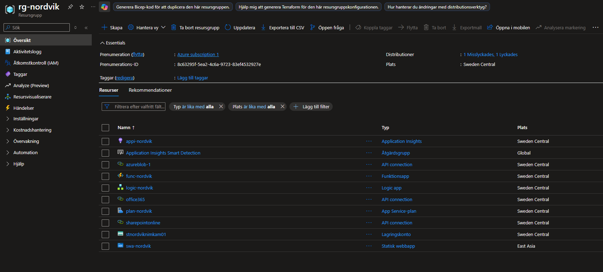
## Återskapa (öppna bash consolen i Azure)
Skapa resursgruppen med namnet rg-nordvik
```
az group create --name rg-nordvik --location swedencentral
```

Ladda ner filerna från nordvik-frontend och nordvik-function https://github.com/nima1233/azure-MOV25/tree/main/examination

Klicka på Hantera filer i consolen och Ladda upp, välj filen azuredeploy.json som ligger i nordvik-function

Kör what-if och se ifall den klagar på storage account namn
```
az deployment group what-if --resource-group rg-nordvik --template-file azuredeploy.json
```

Deploya
```
az deployment group create --resource-group rg-nordvik --template-file azuredeploy.json
```

När allt skapas upp går vi in in resurs gruppen vi skapade i portalen > klicka på swa-nordvik och kopiera Webbadress i Overview > Essentials uppe

Öppna Microsoft Entra, Under Entra ID > App registrations > New registration.   
Namn: Nordvik Portal     
Supported account types: Single tenant only - Default Directory
Redirect URI: Single-page applikation (SPA) - Skriv in din swa adress och /redirect.html på slutet exempel ```https://gray-pond-01557f300.4.azurestaticapps.net/redirect.html```    
### Portal skapad, spara (client) ID, och (tenant) ID
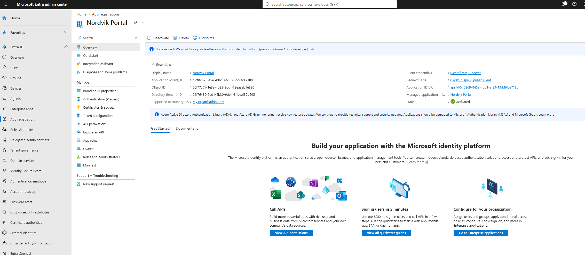

Klicka på Expose an API > Application ID URI > Add, ändra inte default API den ger och klicka på Save   

Nu ser vi en API uppe i sidan kopiera den och klicka på Add a scope under   
Scope name: access_as_user  
Who can consent?: Admins and users  
Admin consent display name: access portal   
Admin consent description: access portal as admin   
User consent display name: access portal    
User consent description: access portal as user 
State: Enabled  

### Application ID URI och Scope access_as_user skapad
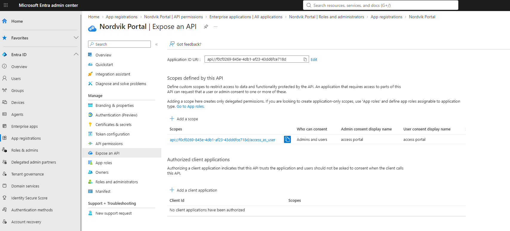

Klicka på App roles under Expose an API > Create app role, här behöver vi tre roller    
Display name: Tenant    
Allowed member types: Users/Groups  
Value: Tenant   
Description: Allows tenants to submit and view their own reports.   

Display name: Manager    
Allowed member types: Users/Groups  
Value: Manager   
Description: Allows property managers to view and edit all reports. 

Display name: Finance    
Allowed member types: Users/Groups  
Value: Finance   
Description: Allows finance users to view all reports.

### Tre st app roller skapade
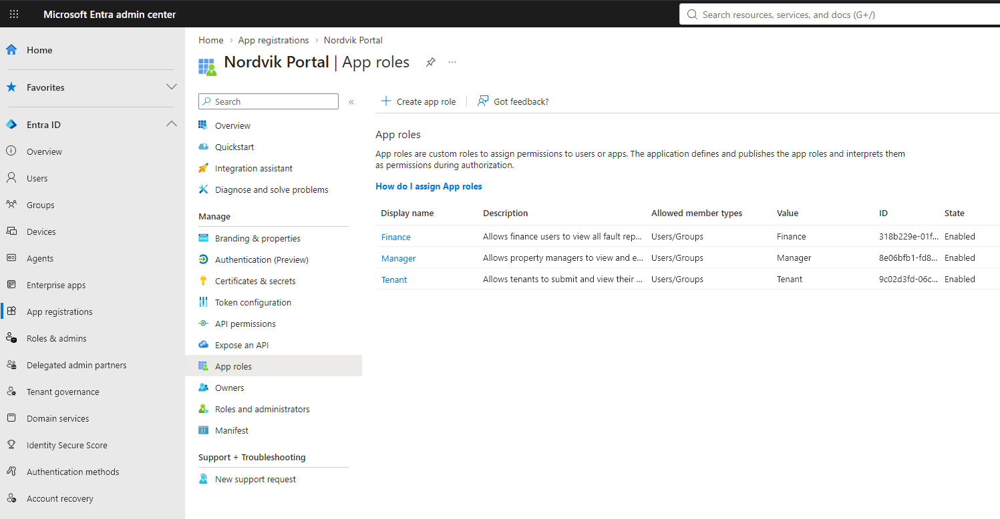

Klicka på Enterprise apps i menyn till vänster ovanför App registration där vi är   
Öppna Nordvik Portal > Users and groups     
Här delar vi ut rollerna vi skapade till användare eller grupper. Den ska egentligen delas ut till en säkerhetsroll tex. SEC_forvaltare men min prenumeration tillåter endast utdelning till användare.

Add user/group
### Jag kan endast dela ut rollen till användare pga min plan level
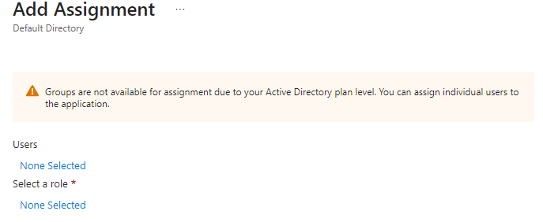  
Välj grupp som dina hyresgäster är medlem i     
Select a role: Tenant   

Add user/group  
Välj grupp som dina förvaltare är medlem i  
Select a role: Manager  

Add user/group  
Välj grupp som din ekonomiavdelning är medlem i     
Select a role: Finance

### Tre st användare skapade med olika roller
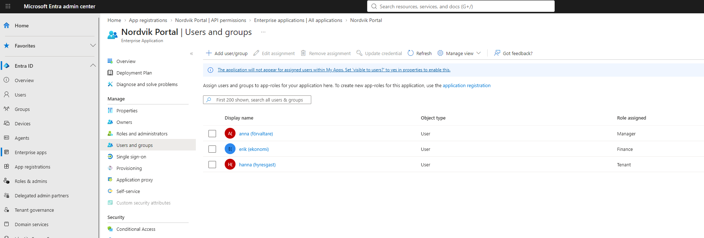

### Entra ID delen klar

## Redigera nedladdade filerna
Öpnna nordvik-frontend > index.html     
Hitta: const CLIENT_ID och const TENANT_ID      
Här ska din client id och tenant ID från portalen du skapade i Entra vara   
Öppna redirect.html i samma mapp och ändra värden där också.

## Azure portal
Nu ska func konfigureras så att den kan kommunicera med Portalen vi skapade i Entra med rollerna
Gå in i din resursgrupp som skapades > funktionsappen func-nordvik > Inställningar > Autentisering > Lägg till identitetsprovider   
Identitetsprovider: Microsoft   
Personalkonfiguration (aktuell klientorganisation)  
Appregistreringstyp: Välj en befintlig appregistrering i den här katalogen  
Namn eller app-ID: Nordvik Portal   
Upphörande av klienthemlighet: 180 dagar    
Oautentiserade begäranden: HTTP 401 Ej auktoriserad     
Lägg till
### Autentisering för func skapad kopiera App-ID (klient)
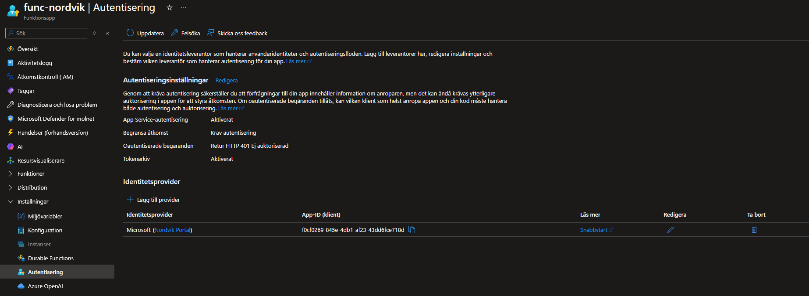
Klicka på redigera nere åt höger, här ska endast Tillåtna tokenmålgrupper ändras    
Värdet ska vara: api://DIN_KLIENT_ID    
För den här konfiguration blir min token audience ```api://f0cf0269-845e-4db1-af23-43dd6fce718d```  

Ladda upp filerna som du laddade ner och redigerade. Allt från nordvik-frontend(client id och tenant id i nordvik-frontend ska redan vara konfigurerade för din miljö) och nordvik-function.
Filerna som laddas upp blir då: index.html, redirect.html, host.json, index.js, package-lock.json, package.json 

## SKAPA MAPPAR I CONSOLE OCH FRONTEND (bash console i Azure)
1. skapa mappar:
```
mkdir -p ~/nordvik-frontend ~/nordvik-function
```

2. flytta filer till mappar:
```
mv ~/index.html ~/redirect.html ~/nordvik-frontend/
```

3. flytta filer till mappar:
```
mv ~/index.js ~/host.json ~/package.json ~/package-lock.json ~/nordvik-function/
```

4. nu visas index.html och redirect.html
```
ls -l ~/nordvik-frontend
```

5. nu visas index.js, host.json, package.json, package-lock.json
```
ls -l ~/nordvik-function
```

6. Kör denna:
```
cd ~ && mkdir -p nordvik-deploy && cp ~/nordvik-frontend/index.html ~/nordvik-deploy/ && cp ~/nordvik-frontend/redirect.html ~/nordvik-deploy/
```


7. båda .html filerna ska visas:
```
ls -l ~/nordvik-deploy
```

8. hämta Static Web App deployment token:
```
az staticwebapp secrets list --name swa-nordvik --resource-group rg-nordvik --query properties.apiKey --output tsv
```

9. kopiera din token den ska användas i nästa command:

10. klistra in din token där det står DIN TOKEN HÄR, skriv 'y' vid "ok to proceed?"
```
npx @azure/static-web-apps-cli deploy ~/nordvik-deploy --deployment-token "DIN_TOKEN_HÄR" --env production
```

### frontend deployad till Static Web App

## BACKEND (bash console i Azure)

1. index.js, host.json, package.json, package-lock.json ska visas:
```
ls -la ~/nordvik-function
```

2. Skapa ZIP med filerna:
```
cd ~/nordvik-function
```
```
zip -j ~/nordvik-function.zip host.json index.js package.json package-lock.json
```

3. Kontrollera att ZIP skapades:
```
ls -lh ~/nordvik-function.zip
```

4. Enabla build mode för deployment:
```
az functionapp config appsettings set --name func-nordvik --resource-group rg-nordvik --settings SCM_DO_BUILD_DURING_DEPLOYMENT=true ENABLE_ORYX_BUILD=true
```

5. Deploya:
```
az functionapp deployment source config-zip --name func-nordvik --resource-group rg-nordvik --src ~/nordvik-function.zip
```

6. När den deployat klart kör:
```
grep -nE "app\.http|require\(.*@azure/functions"   ~/nordvik-function/index.js
```
'report', 'reports', 'report-image', 'update-report', ska visas här. De 4 functionerna vi behöver för att få backend att funka på formulär sidan

### Backend skapad, functions app func-nordvik konfigurerad
Nu kollade vi med sista kommandon att funktionerna är uppsatta i func-nordvik, i portal går det också att kolla. Gå in i func-nordvik > ser vi på första sidan att dessa 4 funktioner finns.
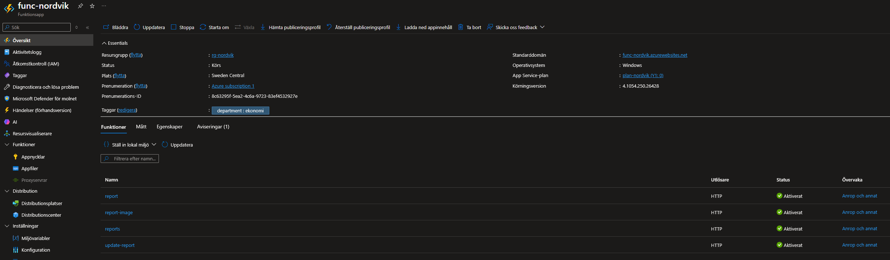

## Nu är hela miljön uppsatt, här kommer lite bilder på Azure inställningar och resurser
CORS som sätts upp automatiskt med template. Template tar din swa adress och lägger in den i CORS under func-nordvik.
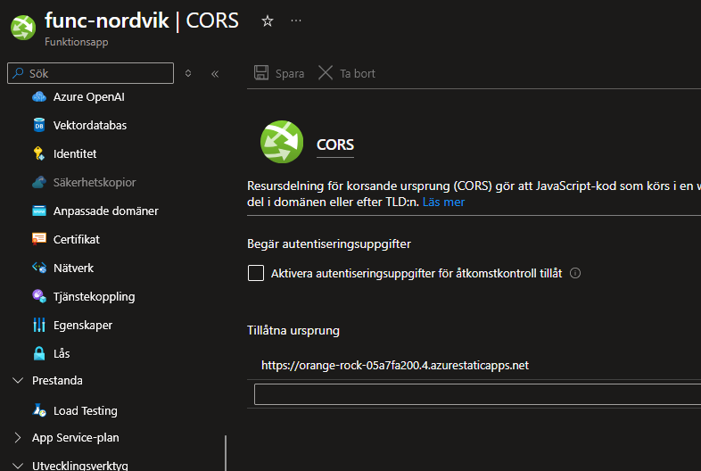

IAM i felanmälan containern. vår func app har Storage Blob Data-contributor genom Hanterad identitet. Vår Logic app har Storage Blob Data-reader genom Hanterad identitet. Dessa sätts upp automatiskt med temmplate. 
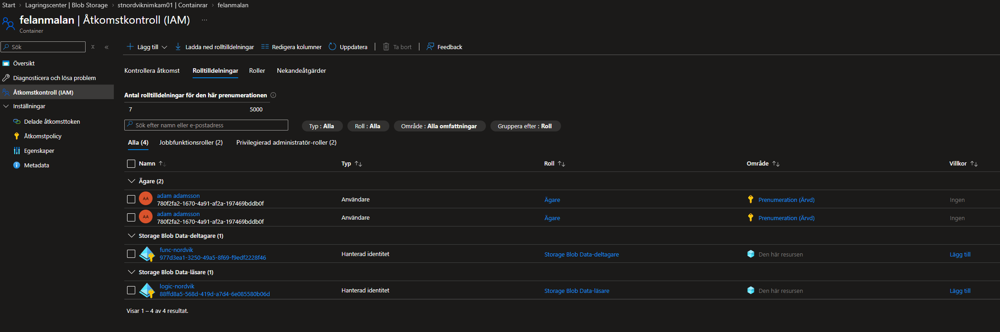

Logic app, flow sätts upp automatiskt med template. Behöver endast konfigurerar connections och ansluta till M365 för din miljö för att mail och sharepoint delen ska funka. Blob trigger och hämta blobinnehåll funkar direkt från template.
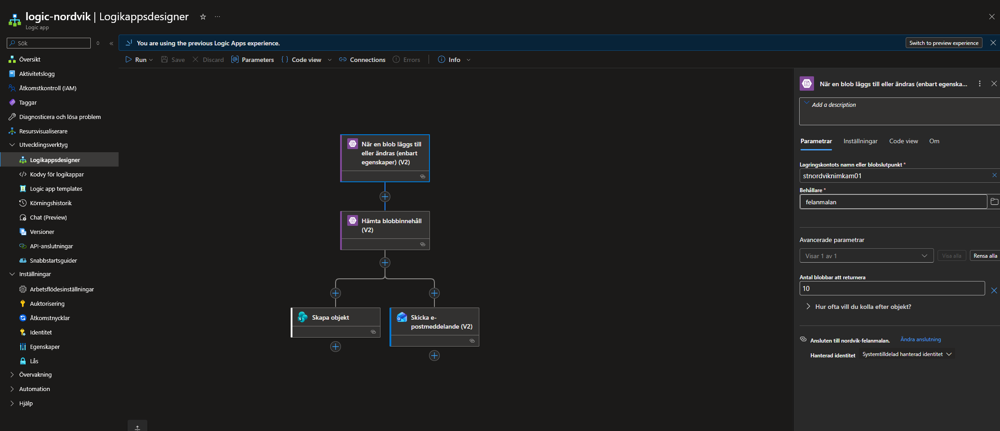

## Bilder som visar att miljön funkar
Startsida
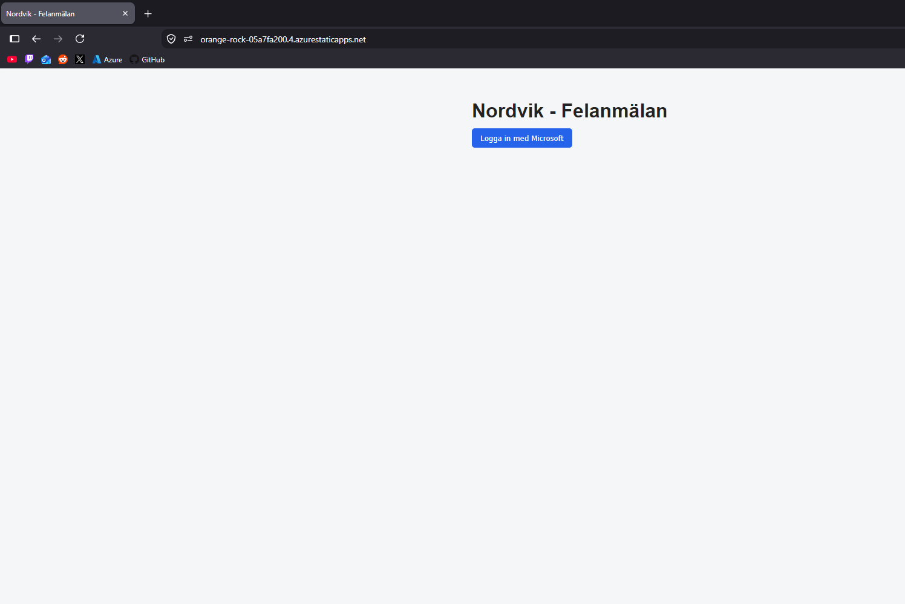

När man klickar på Logga in med Microsoft
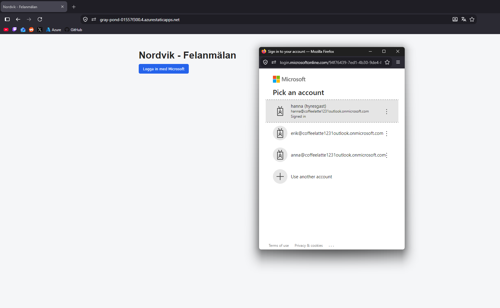

Hyresgäst har skickat en felanmälan. Bekräftelse att den skickats visas med ID.
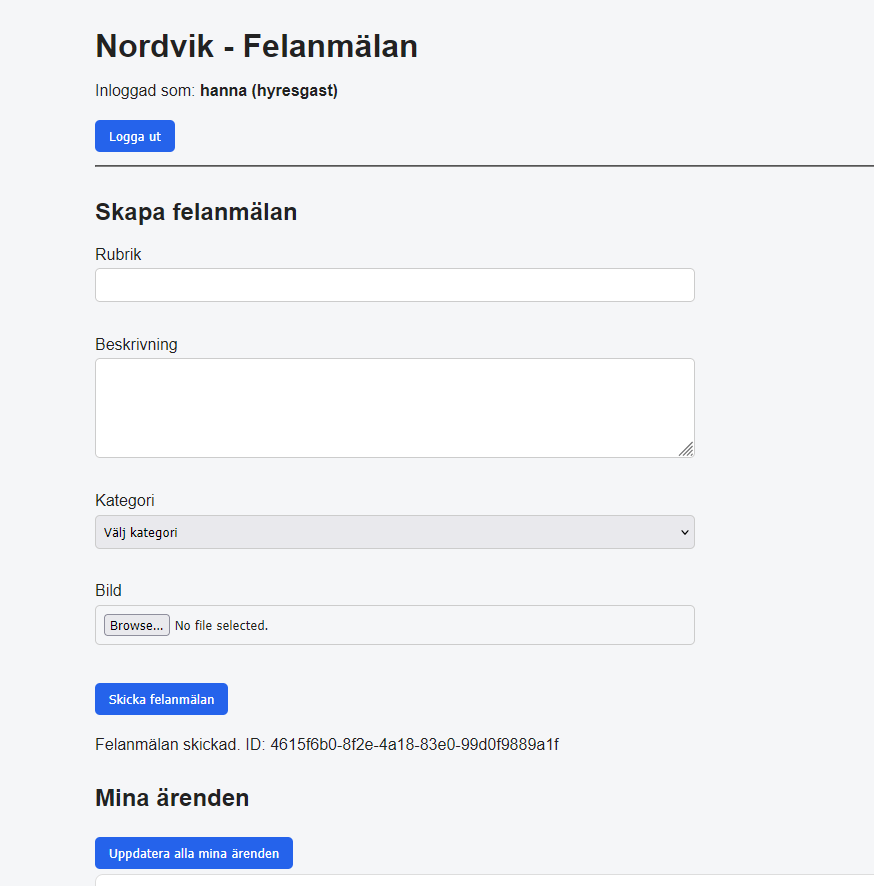

Här kan hyresgästen se sina ärenden
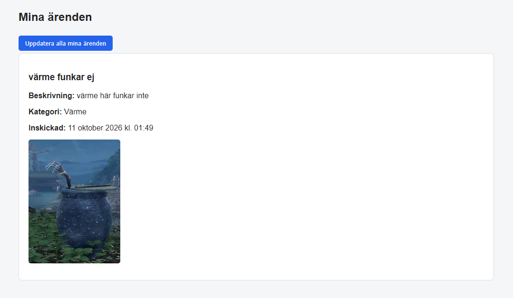

Förvaltare kan se alla ärenden. Förvaltare har även möjlighet att skapa felanmälan
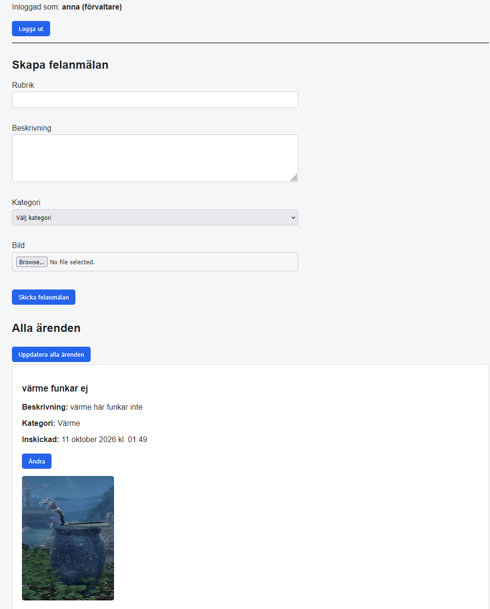

Förvaltare kan modifiera ett ärende
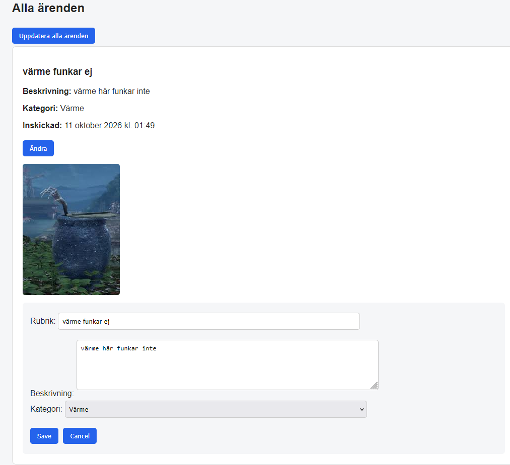

När förvaltare klickar Save visas bekräftelse och sidan laddar om automatiskt med uppdaterade uppgifter
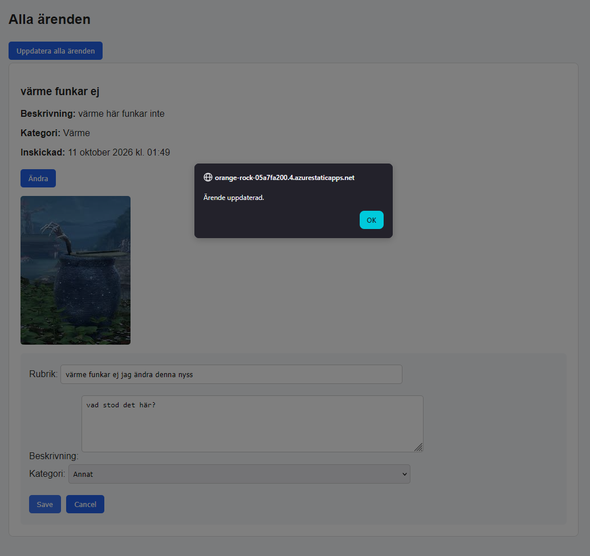

Uppdaterade uppgifter efter sidan laddade om
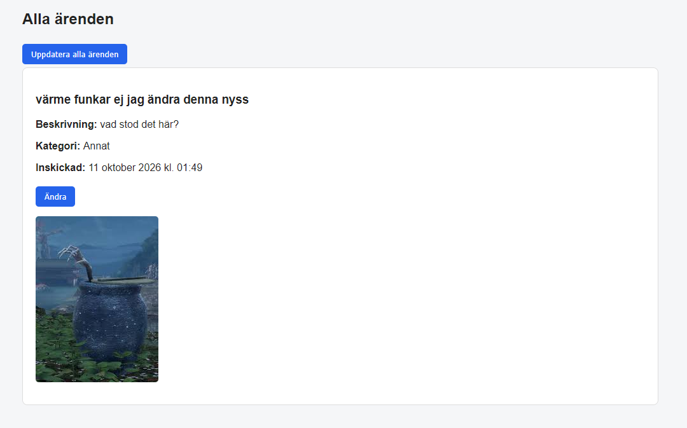

Ekonomi användare har läsande insyn. Här försöker jag skapa ärenden men får Fel: Du har inte behörighet. Ekonomi kan heller inte Ändra ärenden
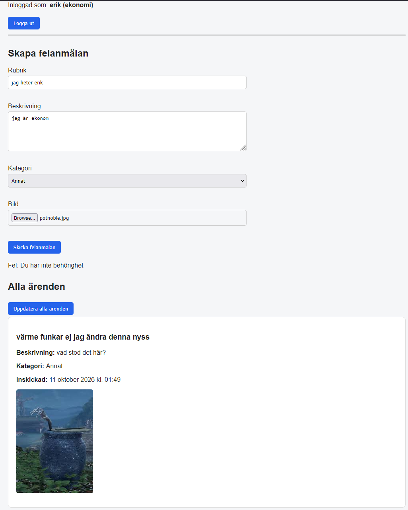

Skickad ärende leder till notis till förvaltare mail
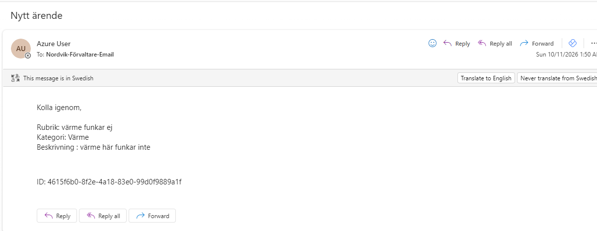

Skickad ärende leder till skapad lista i SharePoint
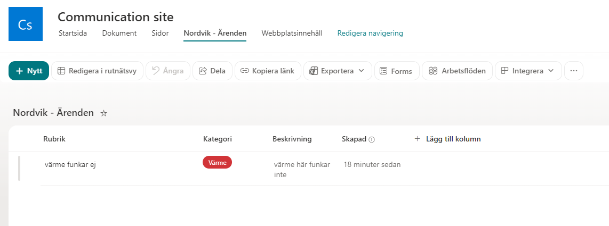

Fin bild på hela miljön
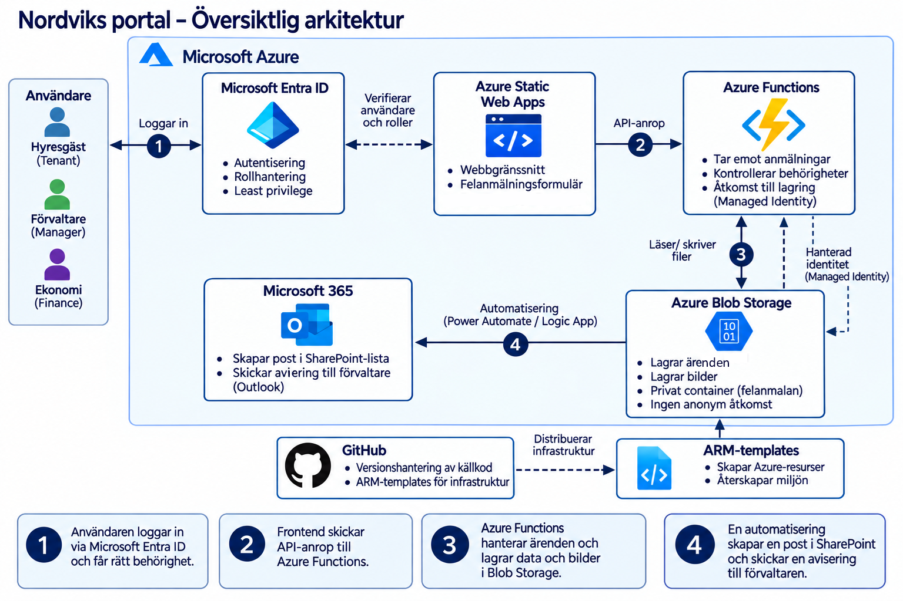